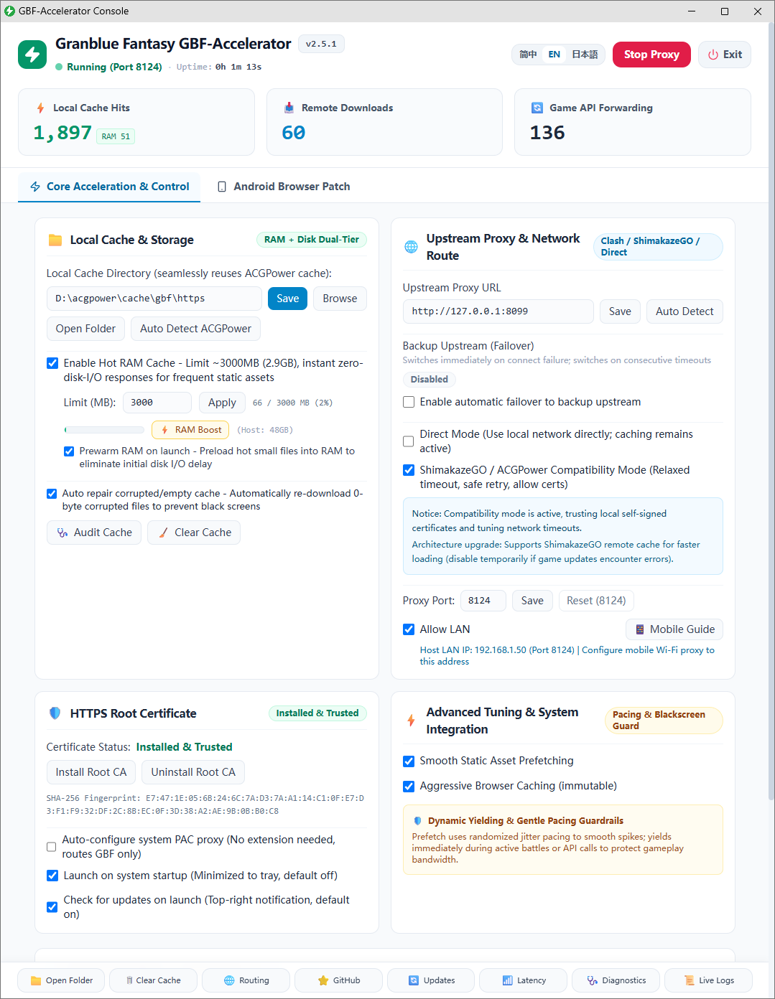
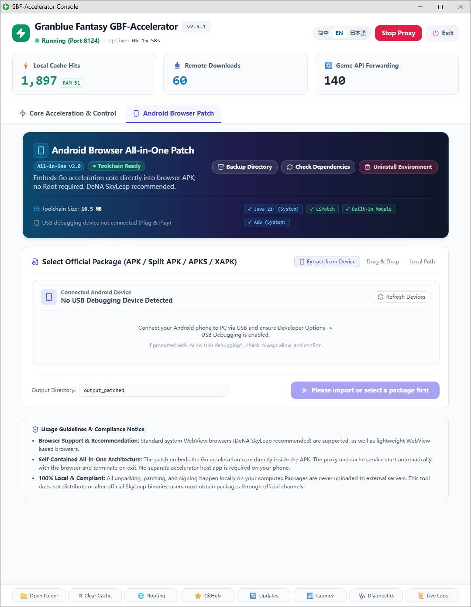
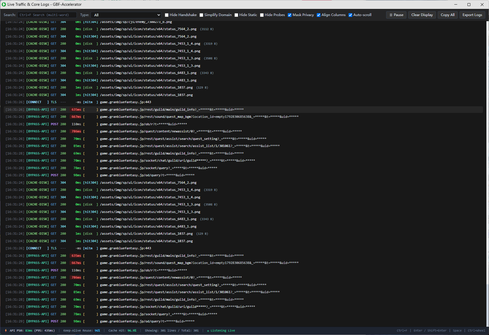
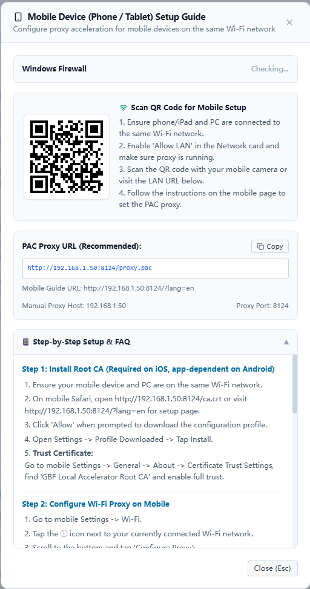
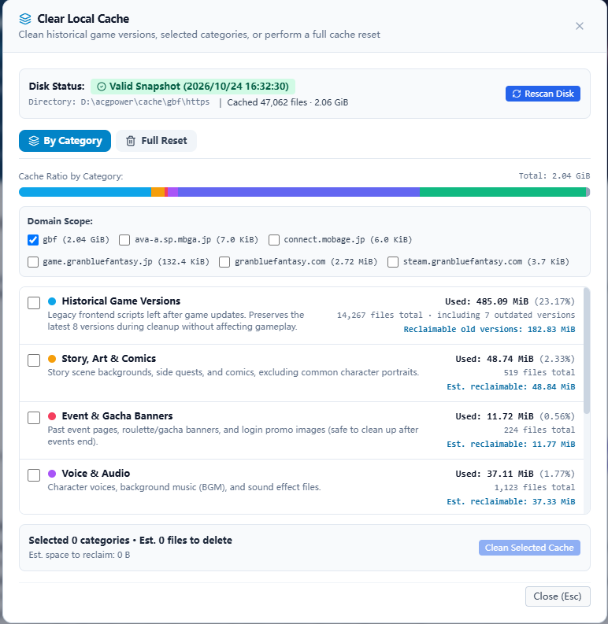
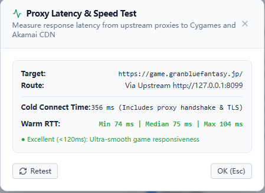
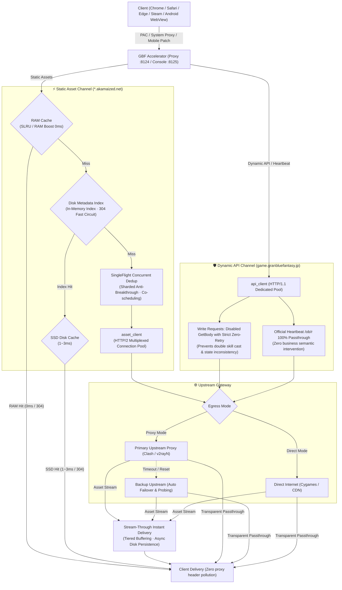

# GBF Accelerator

<p align="center">
  <a href="README.md">简体中文</a> | <b>English</b> | <a href="README.ja.md">日本語</a>
</p>

High-performance local static asset caching and transparent proxy tool for Granblue Fantasy.

[](https://github.com/Sagisawa/GBF-Accelerator/releases)
[](https://go.dev/)
[%20%7C%20Android-informational.svg)]()
[](https://github.com/Sagisawa/GBF-Accelerator/actions/workflows/ci.yml)
[](LICENSE)

GBF-Accelerator caches static game assets (character portraits, audio, battle animations, scripts) to local RAM and SSD using hierarchical caching and HTTP/2 multiplexing. This minimizes redundant overseas downloads, substantially reduces asset loading latency, and mitigates upstream CDN load. Simultaneously, it provides a dedicated HTTP/1.1 Keep-Alive connection pool for core dynamic game APIs (battles, party formation, gacha, quests, settlements), delivering end-to-end transparent forwarding with zero business semantic modification.

> 📥 **Download Ready-to-Use Releases**: Visit [GitHub Releases](https://github.com/Sagisawa/GBF-Accelerator/releases) for pre-built portable archives:
> - **Windows**: Download `GBF_Accelerator_v2.5.1_GUI.zip`, extract and run.
> - **macOS**: Download `GBF_Accelerator_v2.5.1_macOS_universal2.zip` (Universal 2 fat binary supporting Intel and Apple Silicon Macs natively), extract and run.
> - **Android**: Supports both **Root (LSPosed module)** and **No-Root (built-in patcher)** modes.
> - Detailed release notes and changelogs can be found in [CHANGELOG.md](CHANGELOG.md).

---

## UI Preview

| Web Console Dashboard | Android No-Root Browser Patcher Workbench |
| :---: | :---: |
|  |  |

| Real-Time Live Logs & Telemetry |
| :---: |
|  |

| Mobile Setup Guide | Cache Health & Safe Slimming |
| :---: | :---: |
|  |  |

| Dual-Route Latency Benchmark |
| :---: |
|  |

---

## Architecture & Data Flow

This tool adopts a **Dual-Plane (Data Plane & Control Plane) port topology isolation** architecture, balancing high-throughput static caching, transparent dynamic API forwarding, and lightweight cross-platform management:

- **Data Plane (Core Proxy, default `:8124`)**: Intercepts client traffic, performs MITM TLS termination, manages multi-tier static caching, forwards dynamic APIs via dedicated pools, and serves PAC scripts and the Root CA.
- **Control Plane (Management Console, default `:8125`)**: Serves local REST APIs, real-time SSE telemetry streams, and the embedded React console. Strictly bound to loopback (`127.0.0.1`), hardened with DNS Rebinding protection and Host / Origin whitelist validation.
- **Host Integration Layer (Desktop Integration)**: Zero external Python or Electron runtime dependencies. Automatically manages system PAC proxy settings, Keychain / CertUtil stores, and mounts a native standalone window via Chromium App Mode with system tray integration.

### Core Data Flow Diagram



### Transaction & Security Boundaries

Strict port boundary definitions ensure core security invariants:

- **8124 = Data Plane**:
  - Default bind: `127.0.0.1` (Loopback only).
  - When LAN sharing is enabled (`AllowLAN = true`): dynamically rebinds to `0.0.0.0`.
  - Roles & public endpoints:
    - HTTP / HTTPS core proxy forwarding and traffic dispatching.
    - `/ca.crt`: Direct Root CA certificate download.
    - `/proxy.pac`: PAC auto-configuration proxy script.
    - LAN mobile onboarding guide landing page.
- **8125 = Control Plane**:
  - Bind policy: **Strictly bound to `127.0.0.1` (Loopback-only), never exposed to LAN**.
  - Roles & management endpoints:
    - Embedded React SPA web console static assets.
    - REST management APIs (`/api/config`, `/api/status`, `/api/app/quit`, etc.).
    - Real-time SSE telemetry metrics stream.
    - Protected by DNS Rebinding defense and strict Host / Origin header checks.

### Hot-Reload Pipeline & Configuration Transaction

Dynamic configuration reloading (`POST /api/config/apply`) follows a 4-phase strong transaction pipeline:

```text
[Candidate] (Validation and normalization on candidate clone)
    ↓
[Commit] (Atomic in-memory commit and synchronous disk save)
    ↓
[Listener Rebind] (Network transaction rebind: ports 8124 / 8125 and host rebind)
    ↓
[Post-Commit Runtime Sync] (Best-effort runtime sync: cache dir, RAM limit, PAC, startup)
```

---

## Core Feature Matrix

### ⚡ High-Performance Streaming, Traffic Pacing & Physical Isolation
- **Stream-Through Delivery with Zero TTFB Overhead**:
  - Unlike legacy proxies that buffer an entire payload before delivering, cache-miss requests stream directly to the client as chunks arrive from upstream.
  - Large character portraits, high-definition audio, and battle animations render immediately without waiting for disk writes to complete.
- **Tiered Buffering Strategy**:
  - Small assets use efficient memory buffers.
  - Medium assets flow through streaming memory pipelines.
  - Very large assets spill to secure temporary files, preventing sudden memory spikes and OOM.
- **Direct Disk Read for Large Assets (> 2MB)**:
  - Assets larger than 2MB are read directly from disk into client delivery channels, strictly bypassing the RAM SLRU probationary cache to protect resident hot resources.
- **Dual-Channel Physical Isolation**:
  - **Dynamic API Channel (`api_client`)**: Dedicated HTTP/1.1 Keep-Alive pool for `game.granbluefantasy.jp`, eliminating repeated TLS handshake latencies.
  - **Static Asset Channel (`asset_client`)**: HTTP/2 multiplexing for Akamai CDN, pulling multiple asset chunks concurrently over persistent streams.
  - **Zero Connection Contention**: Background prefetching runs on dedicated asset connections and will never block or delay game dynamic APIs.
- **QoS Foreground Yielding**:
  - Background prefetch workers dynamically monitor foreground requests. When active battles or page navigation calls are detected, background prefetching yields immediately to protect game bandwidth.
- **Safe Multi-Layer Retry Guardrails**:
  - **Zero Retry on Write Requests**: All state-modifying requests (attacks, skill casts, summons, purchases) have application-level `max_attempts = 1`. `upReq.GetBody` is explicitly nilled out at runtime to mitigate implicit transport-level retries in Go's standard library.
  - **Audited Idempotent Read Retry**: Only pre-audited read-only GET endpoints (such as `/rest/multiraid/condition.json`, `/rest/quest/stage_list`, etc.) are permitted at most 1 fast reconnection attempt upon connection reset/EOF.
- **Real-Time Telemetry & Multi-Keyword Log Analysis**:
  - Pushes connection reuse status, latency distributions (P50/P95/P99), and throughput stats via Server-Sent Events (SSE).
  - Terminal log search supports space-separated multi-token matching, case-insensitive highlighting, and module filtering.

### 💾 Multi-Tier Caching System & Intelligent Prefetching
- **RAM Cache with SLRU (Segmented LRU) Admission Protection**:
  - High-frequency static assets reside directly in memory (default 256MB, configurable up to 64GB) with near 0ms latency.
  - Segmented LRU prevents large bulk prefetch items from evicting critical foreground UI assets.
- **RAM Boost with Low-Memory Stop Guard**:
  - Provides an optional RAM Boost mode to load all static assets into an immutable resident pool. Real-time physical memory watermarks automatically halt preloading if system memory falls below safe thresholds.
- **Disk Metadata Index**:
  - File presence and metadata are indexed in memory. HEAD requests and 304 conditional negotiations short-circuit instantaneously with zero disk I/O.
- **DeadFilter (404/410 Asset Filter with Exponential Backoff)**:
  - Tracks non-existent upstream assets to prevent prefetch request storms on dead links. Strictly applies to background prefetch; foreground requests always pass through directly.
- **SingleFlight Concurrent Deduplication**:
  - Concurrent requests for identical uncached assets are coalesced into a single upstream request via sharded locks, reducing upstream CDN pressure.
- **Smooth Prefetching with Jitter Scheduling**:
  - Asset prefetch tasks use 15–35ms random jitter pacing to smooth request bursts and avoid burst spikes on CDN edges.
- **Safe Cache Slimming**:
  - Automatically rotates and removes expired game version directories while preserving the most recent versions (default: 8 versions).

### 📱 Android Integration & Patcher Tooling
- **No-Root PC Patcher Workbench**:
  - The Web Console includes an **Android Browser Patcher** tool integrating AAPT2, LSPatch, and the Go mobile core.
  - Drag and drop an official SkyLeap (or Chromium-based WebView browser like Via) APK into the console to inspect, patch, and install directly to a connected phone with USB debugging.
- **Automatic Patched APK Detection & Clean Upgrade**:
  - Automatically identifies existing LSPatch metadata, package names, and versions. Supports dropping in previously patched APKs to update the accelerator core seamlessly without manual decompilation.
- **Root / LSPosed Module**:
  - Provides a pre-compiled `GBF_Accelerator_v2.5.1_Xposed_arm64.apk` for rooted devices. Activate in LSPosed and select SkyLeap as scope for instant native acceleration.
- **Mobile Sandbox & Battery Friendliness**:
  - RAM caching and background prefetching are disabled by default on mobile to minimize power and cellular data consumption.
  - *Android Process Freezer Note*: Android's cgroup v2 freezer suspends background processes. When switching between multiple patched browsers on the same phone, swipe away the previous browser from the recent apps switcher to release port 8124.

### 🖥️ Native Desktop & OS Integration
- **Windows Integration**:
  - Frameless standalone console window powered by Chromium App Mode with native dark theme.
  - Zero Electron and zero Python runtime dependencies.
  - System tray icon with quick actions (Start/Stop, Open Console, Open Cache Folder, Quit).
  - Automated WinINet system PAC configuration and system proxy conflict detection.
  - Inbound firewall rule adapter (strictly scoped to Private + LocalSubnet + TCP + Port).
  - Automated Root CA certificate installation and removal via `certutil`.
- **macOS Integration**:
  - Universal 2 fat binary supporting Apple Silicon (M1/M2/M3/M4) and Intel Macs natively.
  - Native Menu Bar tray icon and menu for quiet background operation.
  - Automatic system PAC configuration via `networksetup`.
  - Automatic Keychain trust management via `security add-trusted-cert`.
- **Linux & Headless Mode**:
  - Runs with `--headless` (or `-nogui`) for Linux servers, containers, or remote VMs.
  - See [docs/MAC_LINUX_NOGUI.md](docs/MAC_LINUX_NOGUI.md) for details.
- **LAN Mobile Access**:
  - Toggle "Allow LAN" to connect iPhones, iPads, and other devices on the same Wi-Fi.
  - Mobile landing page at `http://<LAN_IP>:8124/` provides one-click PAC link copying and QR code certificate installation.

### 🛡️ Security, Zero Tampering & Transparency
- **Absolute Business Semantic Transparency**: All dynamic APIs (gacha, quests, parties, battles) are forwarded verbatim without modifying status codes, headers, body, or cookies. Multi-line `Set-Cookie` headers are strictly preserved without folding.
- **Official Heartbeat Passthrough**: `/ob/r` (anti-cheat heartbeat) and `/rest/error/js` (frontend error reporting) pass directly to Cygames servers with 100% fidelity.
- **Zero Header Pollution**: No custom headers (`X-Proxy-*`, etc.) are returned to client browsers.
- **Unique Local Root CA**: A dedicated private Root CA is dynamically generated upon first run and stored locally in `certs/`. No shared or hardcoded certificates.

---

## Quick Start

### Option 1: Pre-Built Portable Release (Recommended)

#### Windows
1. Download `GBF_Accelerator_v2.5.1_GUI.zip` from [Releases](https://github.com/Sagisawa/GBF-Accelerator/releases).
2. Extract to any directory without Chinese or special characters (e.g., `D:\GBF_Accelerator\`).
3. **Ensure Upstream Proxy**: Make sure your proxy software (Clash, v2rayN, etc.) is running, or enable "Direct Mode" in settings if you have a direct connection to Japan.
4. **Launch**: Double-click `GBF_Accelerator.exe`.
   > 💡 *SmartScreen*: If Windows Defender SmartScreen shows "Windows protected your PC", click **More info** -> **Run anyway**.
5. **Install Root CA (First Run Only)**:
   - Click **Install Root CA** in the Web Console.
   - Click **Yes** in the Windows security prompt to trust the locally generated CA.
   - **Important**: Completely restart your browser (close all windows) to reload the system certificate trust store.
6. **Configure Browser Routing**:
   - **Extension Routing (Recommended)**: In SwitchyOmega / ZeroOmega, create a PAC profile pointing to `http://127.0.0.1:8124/proxy.pac`.
   - **System Proxy**: Or check "Auto-configure system PAC proxy" in the console.
7. **Start Game**: Open `https://game.granbluefantasy.jp` in your browser.

#### macOS
1. Download `GBF_Accelerator_v2.5.1_macOS_universal2.zip` from [Releases](https://github.com/Sagisawa/GBF-Accelerator/releases).
2. Extract and move `GBF_Accelerator.app` into your `/Applications` folder.
   > 💡 *Gatekeeper*: If prompted that the app is from an unidentified developer, right-click the app and choose **Open**, or run in Terminal: `xattr -cr /Applications/GBF_Accelerator.app`.
3. Launch the app. It will run quietly in your top Menu Bar.
4. Click the Menu Bar icon, open the console, and click **Install Root CA** (enter your Mac password/Touch ID to trust the certificate in Keychain).
5. **Restart your browser** (`Cmd + Q`), configure the PAC profile (`http://127.0.0.1:8124/proxy.pac`), and start playing.

#### Android

##### Method A: No-Root (Recommended)
1. Prepare an official SkyLeap APK or a Chromium-based WebView browser APK (e.g. Via).
2. Launch the desktop accelerator, navigate to the **Android Patch** tab in the Web Console.
3. Drag and drop the APK into the patcher workbench. The tool will verify AAPT2 and dependencies.
4. Click **Start Patching**.
5. Once completed, connect your phone via USB with USB debugging enabled and click **Install to Phone**, or transfer the patched APK manually.
6. Ensure your phone has a VPN/proxy tool running (Clash, v2rayNG, etc.), then open SkyLeap to play.

##### Method B: Root / LSPosed
1. Download `GBF_Accelerator_v2.5.1_Xposed_arm64.apk` from [Releases](https://github.com/Sagisawa/GBF-Accelerator/releases).
2. Install the module, activate it in LSPosed Manager, and set SkyLeap as the scope.
3. Restart SkyLeap.

---

### Option 2: Run from Source

#### Prerequisites
- **Go 1.27+**
- Windows 10/11, macOS 12+, or Linux
- **Node.js 18+** (only required if rebuilding the `web/` frontend)

#### Run on Windows
```powershell
git clone https://github.com/Sagisawa/GBF-Accelerator.git
cd GBF-Accelerator\engine
go run .
```

#### Run on macOS
```bash
git clone https://github.com/Sagisawa/GBF-Accelerator.git
cd GBF-Accelerator
./install_ca.sh
./start_proxy.sh
```

#### Headless / Linux Server
```bash
cd engine
go run . --headless
```

---

## Configuration Reference (`config.json`)

On first launch, `config.json` is generated in the root directory. It can be modified via the Web Console or edited directly:

```json
{
  "listen_host": "127.0.0.1",
  "listen_port": 8124,
  "control_port": 8125,
  "allow_lan": false,
  "upstream_proxy": "auto",
  "backup_upstream_proxy": "",
  "enable_upstream_failover": false,
  "upstream_failover_threshold_ms": 2000,
  "upstream_failover_consecutive_failures": 3,
  "upstream_failover_cooldown_seconds": 60,
  "upstream_failover_auto_recover": true,
  "direct_mode": false,
  "cache_dir": "auto",
  "clean_zombies": true,
  "auto_system_proxy": false,
  "auto_start": false,
  "enable_ram_cache": true,
  "ram_cache_max_mb": 256,
  "enable_browser_cache": true,
  "enable_auto_repair": true,
  "enable_prefetch": true,
  "enable_ram_warmup": false,
  "ram_warmup_max_items": 1500,
  "verify_upstream_tls": true,
  "shimakaze_mode": false,
  "auto_check_update": true,
  "api_max_connections": 16,
  "api_max_keepalive": 4,
  "api_keepalive_expiry": 20.0,
  "asset_max_connections": 32,
  "asset_max_keepalive": 16,
  "asset_keepalive_expiry": 60.0,
  "enable_api_telemetry": true,
  "language": "zh",
  "window_width": 880,
  "window_height": 640,
  "window_maximized": false
}
```

| Key | Type | Default | Description |
| :--- | :--- | :--- | :--- |
| `listen_port` | integer | `8124` | Core proxy port for game traffic dispatching. |
| `control_port` | integer | `8125` | Web Console and management REST API port (loopback-only). |
| `allow_lan` | boolean | `false` | Whether to allow other devices on the LAN to connect to port 8124. |
| `upstream_proxy` | string | `"auto"` | Primary upstream proxy. `"auto"` auto-probes ports 7897/7890/8123/10808/10809. |
| `backup_upstream_proxy` | string | `""` | Backup upstream proxy address or `"direct"` for physical direct fallback. |
| `enable_upstream_failover` | boolean | `false` | Whether to enable automatic failover to the backup upstream proxy. |
| `direct_mode` | boolean | `false` | Direct mode; bypasses upstream proxies while preserving local static caching. |
| `cache_dir` | string | `"auto"` | Cache storage directory. Auto-detects ACGPower cache or uses `cache/gbf/https`. |
| `auto_system_proxy` | boolean | `false` | Automatically configure system PAC proxy on startup and revert on exit. |
| `enable_ram_cache` | boolean | `true` | Enable RAM hot-spot caching (Segmented LRU). |
| `ram_cache_max_mb` | integer | `256` | RAM cache limit in MB (supports 16 to 65536 MB). |
| `enable_prefetch` | boolean | `true` | Enable background smooth prefetching with random jitter pacing. |
| `language` | string | `"zh"` | Console and tray display language: `"zh"` (Chinese), `"en"` (English), `"ja"` (Japanese). |
| `window_width` | integer | `880` | Standalone console window width. |
| `window_height` | integer | `640` | Standalone console window height. |

---

## Practical FAQ

### Q1: The browser shows "Certificate Invalid" or `NET::ERR_CERT_AUTHORITY_INVALID`?
- **Cause**: The local proxy decrypts and caches HTTPS static assets, which requires trusting the local private Root CA generated on your machine.
- **Solution**:
  - **Windows**: Click **Install Root CA** in the Web Console (or run `install_ca.bat` as administrator), then **completely restart your browser**.
  - **macOS**: Run `./install_ca.sh` (or install via the Web Console) and enter your Mac password, then press `Cmd + Q` to completely quit and restart your browser.
  - **Firefox**: Firefox uses its own certificate store. Import `certs/ca.crt` manually in Firefox Settings -> Privacy & Security -> Certificates -> View Certificates -> Authorities.

### Q2: Why don't "Local Cache Hits" increment immediately when fighting the same raid twice?
- **Explanation**: Modern Chromium browsers (Chrome, Edge) have an internal **Memory Cache**. After an asset is downloaded the first time, the browser serves it directly from tab memory (`from memory cache` in Network devtools) without sending any network request to the proxy.
- **Verification**: Only after the browser's internal memory cache expires, or after completely restarting the browser or revisiting the raid later, requests reach the local proxy and increment the RAM/Disk cache hit counters.

### Q3: How do I reuse existing cache from ACGPower or older accelerators?
- Under **Cache Directory** in the console, click **Browse** and select your existing ACGPower cache folder (e.g., `D:\acgpower\cache\gbf\https`). The accelerator will normalize the path and mount it directly without re-downloading gigabytes of assets.

---

## Testing & Building

### Automated Test Suite
```powershell
cd engine
go test -count=1 ./...
go vet ./...
```

### Packaging Releases
- **Windows**:
  ```powershell
  .\build.ps1 -RebuildWeb
  ```
  The compiled standalone binary is placed in `bin/GBF_Accelerator.exe` and packaged into `release/GBF_Accelerator_v2.5.1_GUI.zip`.
- **macOS Universal 2**:
  ```bash
  ./build.sh --rebuild-web --release
  ```

---

## Security & Disclaimer

- **Local Certificate Isolation**: The Root CA is generated dynamically on first launch and stored locally in `certs/`. Private keys are never transmitted. Domain certificates are constrained strictly to GBF domains.
- **Accurate Domain Scoping**: PAC routing rules only intercept official GBF domains, standard Akamai CDN, and Steam CDN domains. Unrelated traffic is untouched.
- **Business Semantic Transparency**: All dynamic APIs (gacha, battles, quests, settlements, `/ob/r` heartbeats) pass through verbatim with zero payload modification, zero mock responses, and zero custom proxy headers.
- **Disclaimer**: GBF-Accelerator is an open-source network optimization and local static caching middleware. It does not modify game data, frontend scripts, or game memory. Please comply with Cygames' terms of service. Use at your own risk.
