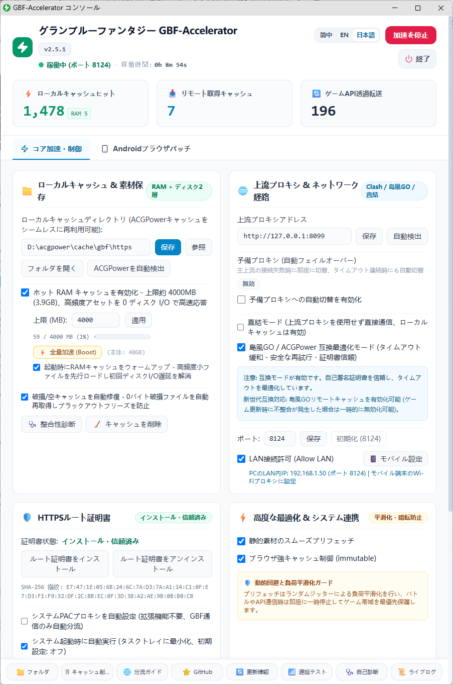
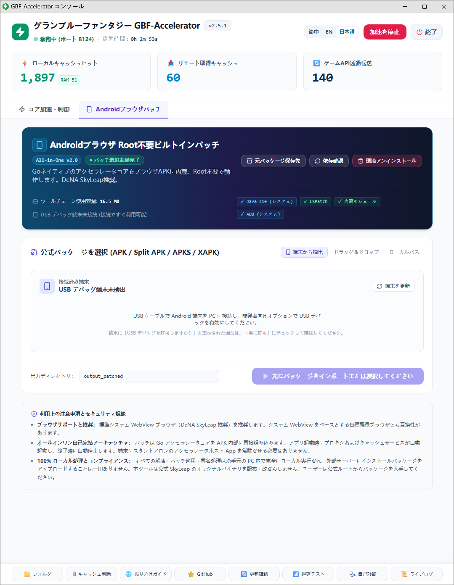
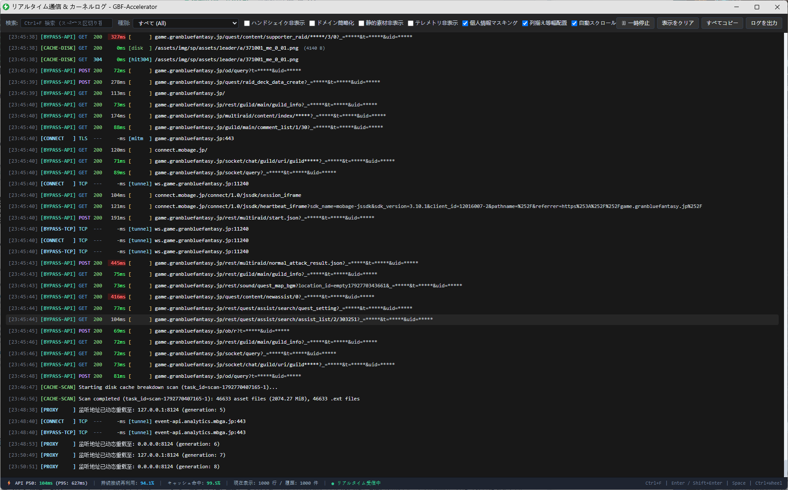
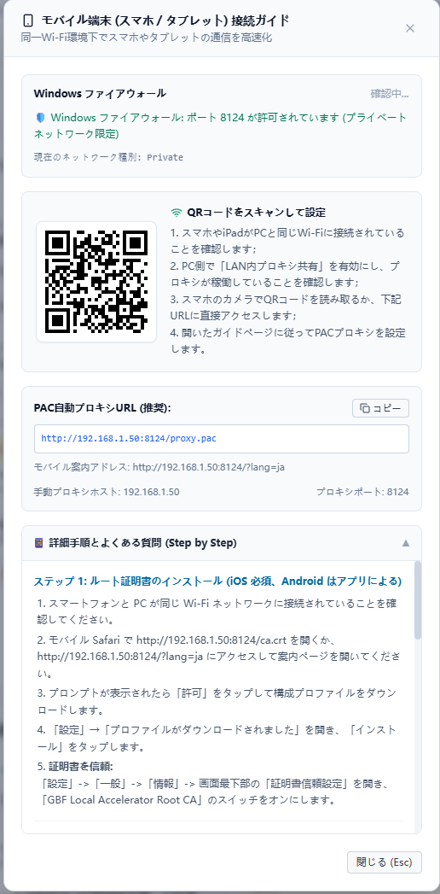
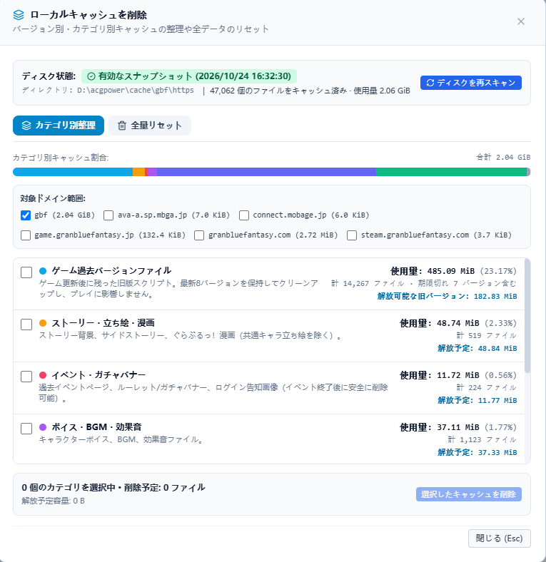
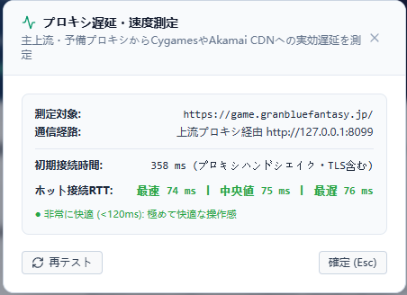
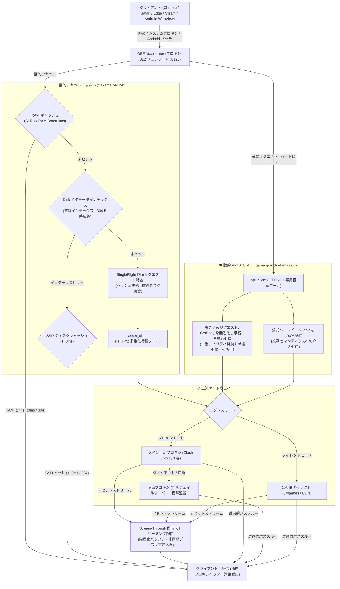

# GBF Accelerator

<p align="center">
  <a href="README.md">简体中文</a> | <a href="README.en.md">English</a> | <b>日本語</b>
</p>

グランブルーファンタジー（Granblue Fantasy）向け 高性能ローカル静的キャッシュ＆透過プロキシツール

[](https://github.com/Sagisawa/GBF-Accelerator/releases)
[](https://go.dev/)
[%20%7C%20Android-informational.svg)]()
[](https://github.com/Sagisawa/GBF-Accelerator/actions/workflows/ci.yml)
[](LICENSE)

GBF-Accelerator は、ローカルの RAM / SSD 階層化キャッシュと HTTP/2 多重化接続を活用し、ゲームの静的アセット（キャラ立ち絵、音声、戦闘アニメーション、スクリプト）をローカルにキャッシュするプロキシツールです。重複ダウンロードを削減してアセット読み込みの遅延を大幅に短縮し、CDN の帯域負荷を軽減します。
同時に、ゲームの動的 API（戦闘、編成、ガチャ、リザルトなど）には独立した HTTP/1.1 Keep-Alive 専用接続プールを提供し、業務セマンティクスへの介入を一切行わない完全な透過プロキシ（Transparent Proxy）転送を行います。

> 📥 **完成版のダウンロード**: [GitHub Releases](https://github.com/Sagisawa/GBF-Accelerator/releases) から最新のポータブルパッケージを入手できます：
> - **Windows**: `GBF_Accelerator_v2.5.1_GUI.zip` を解凍して即実行可能。
> - **macOS**: `GBF_Accelerator_v2.5.1_macOS_universal2.zip`（Intel / Apple Silicon 両対応の Universal 2 バイナリ）。
> - **Android**: **Root（LSPosed）** および **非Root（PC内蔵パッチャー）** の両方に対応。
> - バージョン別の変更履歴は [CHANGELOG.md](CHANGELOG.md) をご覧ください。

---

## 画面プレビュー

| Web コンソールダッシュボード | Android ブラウザ非Root 内蔵パッチツール |
| :---: | :---: |
|  |  |

| リアルタイムログ＆通信テレメトリ |
| :---: |
|  |

| モバイル端末接続ガイド | キャッシュ診断＆安全スリム化 |
| :---: | :---: |
|  |  |

| デュアルルート遅延測定 |
| :---: |
|  |

---

## アーキテクチャとデータフロー

本ツールは、**データプレーン（Data Plane）と制御プレーン（Control Plane）の二重ポート分離**設計を採用しています：

- **データプレーン（コアプロキシ、デフォルト `:8124`）**: クライアント通信のインターセプト、MITM TLS 終端、静的アセットのキャッシュ配信、動的 API の専用プール転送、PAC / ルート証明書の配信を担当。
- **制御プレーン（管理コンソール、デフォルト `:8125`）**: ローカル REST API、リアルタイム SSE テレメトリ、内蔵 React コンソールを提供。ループバック（`127.0.0.1`）に厳格バインドされ、DNS リバインディング防御および Host / Origin ホワイトリスト検証を完備。
- **ホスト統合層（Desktop Integration）**: 外部 Python / Electron ランタイムに依存せず、システム PAC プロキシや証明書ストアを自動管理。Chromium App Mode を通じた独立ウィンドウおよびシステムトレイ常駐をサポート。

### コアデータフロー図



### ポート境界とセキュリティ

- **8124 = データプレーン (Data Plane)**:
  - デフォルト待受: `127.0.0.1` (ループバック限定)。
  - LAN 共有有効化時 (`AllowLAN = true`): 動的に `0.0.0.0` へ再バインド。
  - 公開機能: HTTP/HTTPS プロキシ、`/ca.crt` (証明書直ダウンロード)、`/proxy.pac` (PAC 自動構成スクリプト)、LAN モバイル接続ガイド。
- **8125 = 制御プレーン (Control Plane)**:
  - 待受ポリシー: **常に `127.0.0.1` に厳格バインド（LAN へは絶対に非公開）**。
  - 公開機能: Web コンソール SPA、管理用 REST API (`/api/config`、`/api/status` 等)、SSE テレメトリ。DNS リバインディング防御機能付き。

---

## 主な機能一覧

### ⚡ 高速ストリーミング＆物理分離
- **Stream-Through 即時ストリーミング配信 (TTFB の極小化)**:
  - キャッシュ未ヒットのアセットも、丸ごとダウンロードを待たずに上流から届いたチャンクを即座にブラウザへ配信。大容量の立ち絵や音声も素早く描画開始されます。
- **階層化バッファリング (Tiered Buffering)**:
  - 小容量アセットはメモリバッファ、中容量はストリームパイプ、超大容量アセットは安全な一時ファイルを利用し、突発的なメモリ急増と OOM を防止。
- **大容量アセット (> 2MB) の直接ディスク読み込み**:
  - 2MB を超えるアセットはディスクから直接高速配信し、RAM SLRU の試用段への登録を制限することで、常駐ホットキャッシュ領域を保護。
- **動的 API / 静的アセットの二系統物理分離**:
  - **動的 API チャネル (`api_client`)**: `game.granbluefantasy.jp` 専用の HTTP/1.1 Keep-Alive 接続プール。
  - **静的アセットチャネル (`asset_client`)**: Akamai CDN 向けの HTTP/2 多重化接続プール。
  - アセットのバックグラウンド取得が走っても、動的 API の接続とは完全に分離されており干渉しません。
- **QoS フォアグラウンド優先制御**:
  - フォアグラウンドで戦闘や画面遷移のリクエストが発生すると、バックグラウンドのプリフェッチは自動的に一時停止し、ゲーム帯域を保護します。
- **安全な多層再試行ガードレール**:
  - **書き込みリクエストは再試行厳格ゼロ**: 状態変更を伴う POST リクエスト（攻撃、アビリティ発動、召喚、購入等）は試行回数を厳格に 1 回とし、二重送信を物理的に防止。
  - **監査済み GET リクエストのみ再試行**: 監査済みの冪等 GET API に限り、アイドル接続切断時に最大 1 回の高速再接続を許可。

### 💾 階層化キャッシュ＆スマートプリフェッチ
- **SLRU 方式 RAM キャッシュ**:
  - 高頻度アセットはメモリ上に常駐（標準 256MB、最大 64GB まで設定可能）。アクセス遅延は約 0ms。
  - セグメント化 LRU（SLRU）により、大量の事前読み込みデータがフォアグラウンドの常用アセットを押し出さないよう保護。
- **RAM Boost 常駐モード＆低メモリ自動停止ガード**:
  - アセット全量をメモリ常駐プールに保持する高速化モード。物理メモリ残量をリアルタイムで監視し、閾値を下回った場合は安全のために事前読み込みを自動停止します。
- **Disk メタデータインデックス**:
  - ディスクキャッシュの存在情報をメモリ内にインデックス化。HEAD 要求や 304 条件付きリクエストはディスク I/O なしに即座に 304 応答します。
- **DeadFilter (404/410 アセット動的フィルター)**:
  - 存在しないアセットへの不要な連続プリフェッチを抑制。なお、フォアグラウンドの通常プレイ通信は 100% 上流へ直接通過します。
- **SingleFlight リクエスト重複結合**:
  - 未キャッシュアセットへの同時リクエストをシャードロックで 1 本に統合し、CDN への突発的負荷を抑制。
- **ジッター平滑化プリフェッチ (15〜35ms)**:
  - ランダムジッターを用いてタスクを分散し、CDN へのスパイクアクセスを防止。
- **安全な世代別スリム化 (Cache Slim)**:
  - 直近 N バージョン（標準 8 世代）を残し、古いバージョンのアセットディレクトリを安全に整理。

### 📱 Android モバイル対応
- **非Root PC 内蔵パッチツール**:
  - Web コンソール内の「Android パッチ」タブに、公式 SkyLeap（または WebView 系ブラウザ APK）をドラッグ＆ドロップするだけで、アクセラレータコアを組み込んだ APK を生成可能。
  - USB デバッグ接続時はコンソールから「端末に直接インストール」も可能です。
- **パッチ済み APK の自動認識と更新**:
  - 過去バージョンでパッチ済みの APK をそのまま再投入して、最新コアへワンクリック更新が可能。
- **Root / LSPosed モジュール**:
  - `GBF_Accelerator_v2.4.2_Xposed_arm64.apk` を LSPosed で有効化し、SkyLeap を対象に指定するだけで、APK の改造なしに即座に利用可能。
- **省電力とプロセス仕様**:
  - モバイルコアはバッテリー消費を抑えるため RAM キャッシュとプリフェッチを初期状態でオフに設定。
  - *Android プロセス凍結の注意点*: Android の cgroup v2 freezer 機構により、アプリがバックグラウンドに回ると内蔵コアが一時停止します。同一端末で複数の対応ブラウザを切り替える際は、前のブラウザをタスクスイッチャーで上スワイプして完全に終了させてください。

### 🖥️ デスクトップ＆OS統合
- **Windows**:
  - Chromium App Mode を用いたフレームレス独立ウィンドウ。Electron・Python ランタイム不要。
  - タスクトレイ常駐（開始/停止、コンソール表示、キャッシュフォルダ表示、終了）。
  - WinINet PAC プロキシの自動管理、Windows ファイアウォール規則の適合支援。
  - `certutil` によるルート証明書の自動登録・削除。
- **macOS**:
  - Intel および Apple Silicon（M1〜M4）両対応の Universal 2 バイナリ。
  - メニューバー常駐アイコンによるバックグラウンド動作。
  - `networksetup` による PAC 自動設定、キーチェーン（Keychain）証明書信頼の自動化。
- **Linux / ヘッドレス環境**:
  - `--headless`（または `-nogui`）引数で GUI のないサーバー環境でも動作可能。詳細は [docs/MAC_LINUX_NOGUI.md](docs/MAC_LINUX_NOGUI.md) を参照。
- **LAN 共有**:
  - 「LAN 接続を許可」を有効化すると、同一 Wi-Fi 内の iPhone や iPad からもプロキシとして利用可能。案内ページ `http://<LAN_IP>:8124/` から設定できます。

### 🛡️ セキュリティ・透過性・信頼性
- **業務セマンティクスの完全透過**: ガチャ、編成、クエスト、戦闘などの動的 API は、ステータスコード、ヘッダー、本文、Cookie を一切改変せずにそのまま転送。複数行の `Set-Cookie` も正しく保持。
- **公式ハートビートの完全透過**: `/ob/r`（不正検知ハートビート）および `/rest/error/js`（エラー報告）は Cygames サーバーへ 100% そのまま通過。
- **独自プロキシヘッダー汚染ゼロ**: `X-Proxy-*` などの独自ヘッダーをブラウザへ返却しません。
- **ローカル限定の独自 Root CA**: 初回起動時に端末ローカルで一意の秘密鍵とルート証明書を生成（`certs/` に保存）。共有証明書は一切使用しません。

---

## クイックスタート

### 方法 1: 完成版ポータブル版を使用（推奨）

#### Windows の場合
1. [Releases ページ](https://github.com/Sagisawa/GBF-Accelerator/releases) から `GBF_Accelerator_v2.5.1_GUI.zip` をダウンロード。
2. 日本語やスペースを含まない任意のフォルダ（例: `D:\GBF_Accelerator\`）に解凍。
3. **上流プロキシの確認**: Clash 等のプロキシが起動していることを確認（または設定で「ダイレクト接続」を有効化）。
4. **起動**: `GBF_Accelerator.exe` を実行。
   > 💡 *SmartScreen*: 「Windows によって PC が保護されました」と表示された場合は、「詳細情報」→「実行」をクリックしてください。
5. **ルート証明書のインストール（初回のみ必須）**:
   - Web コンソールの「ルート証明書をインストール」をクリック。
   - Windows の警告画面で「はい」を選択。
   - **重要**: システムの証明書ストアを再読み込みするため、**ブラウザのウィンドウをすべて閉じて完全に再起動**してください。
6. **ブラウザの振り分け設定**:
   - **拡張機能（推奨）**: SwitchyOmega または ZeroOmega で PAC プロファイルを作成し、URL に `http://127.0.0.1:8124/proxy.pac` を設定。
   - **システムプロキシ**: コンソールで「システムPACプロキシを自動設定」にチェックを入れる方法でも利用可能です。
7. **プレイ開始**: ブラウザで `https://game.granbluefantasy.jp` を開いてプレイを開始します。

#### macOS の場合
1. `GBF_Accelerator_v2.5.1_macOS_universal2.zip` をダウンロードし、`GBF_Accelerator.app` を「アプリケーション」フォルダに移動。
   > 💡 *Gatekeeper*: 開発者未確認の警告が出た場合は、右クリックして「開く」を選択するか、ターミナルで `xattr -cr /Applications/GBF_Accelerator.app` を実行してください。
2. アプリを起動するとメニューバーに常駐します。
3. メニューバーアイコンからコンソールを開き、「ルート証明書をインストール」を実行（Mac のパスワードまたは Touch ID で許可）。
4. **ブラウザを完全終了（`Cmd + Q`）して再起動**し、PAC 設定を行ってプレイを開始します。

#### Android の場合

##### 方法 A: 非Root（推奨）
1. 公式 SkyLeap（または WebView 系ブラウザ）の APK を用意。
2. PC 版のコンソールで「Android パッチ」タブを開き、APK をドラッグ＆ドロップ。
3. 「パッチ作成を開始」をクリックしてパッチを適用。
4. スマホを USB 接続して「端末に直接インストール」をクリック（または APK を転送してインストール）。
5. スマホ上で VPN ツール（Clash 等）を接続し、パッチ版 SkyLeap を開きます。

##### 方法 B: Root / LSPosed
1. `GBF_Accelerator_v2.4.2_Xposed_arm64.apk` をダウンロードしてインストール。
2. LSPosed でモジュールを有効化し、SkyLeap を対象にチェック。
3. SkyLeap を再起動します。

---

### 方法 2: ソースコードからビルド

#### 動作要件
- **Go 1.27+**
- Windows 10/11、macOS 12+、または Linux
- **Node.js 18+**（`web/` フロントエンドを再構築する場合のみ）

#### Windows
```powershell
git clone https://github.com/Sagisawa/GBF-Accelerator.git
cd GBF-Accelerator\engine
go run .
```

#### macOS
```bash
git clone https://github.com/Sagisawa/GBF-Accelerator.git
cd GBF-Accelerator
./install_ca.sh
./start_proxy.sh
```

#### Linux サーバー（ヘッドレス）
```bash
cd engine
go run . --headless
```

---

## 設定ファイル（`config.json`）

初回起動時に自動生成されます。Web コンソールから変更できるほか、直接編集も可能です：

```json
{
  "listen_host": "127.0.0.1",
  "listen_port": 8124,
  "control_port": 8125,
  "allow_lan": false,
  "upstream_proxy": "auto",
  "backup_upstream_proxy": "",
  "enable_upstream_failover": false,
  "upstream_failover_threshold_ms": 2000,
  "upstream_failover_consecutive_failures": 3,
  "upstream_failover_cooldown_seconds": 60,
  "upstream_failover_auto_recover": true,
  "direct_mode": false,
  "cache_dir": "auto",
  "clean_zombies": true,
  "auto_system_proxy": false,
  "auto_start": false,
  "enable_ram_cache": true,
  "ram_cache_max_mb": 256,
  "enable_browser_cache": true,
  "enable_auto_repair": true,
  "enable_prefetch": true,
  "enable_ram_warmup": false,
  "ram_warmup_max_items": 1500,
  "verify_upstream_tls": true,
  "shimakaze_mode": false,
  "auto_check_update": true,
  "api_max_connections": 16,
  "api_max_keepalive": 4,
  "api_keepalive_expiry": 20.0,
  "asset_max_connections": 32,
  "asset_max_keepalive": 16,
  "asset_keepalive_expiry": 60.0,
  "enable_api_telemetry": true,
  "language": "zh",
  "window_width": 880,
  "window_height": 640,
  "window_maximized": false
}
```

| 項目 | 型 | 初期値 | 説明 |
| :--- | :--- | :--- | :--- |
| `listen_port` | 整数 | `8124` | コアプロキシの待受ポート。 |
| `control_port` | 整数 | `8125` | Web コンソールおよび管理 API の待受ポート（ローカル限定）。 |
| `allow_lan` | 真偽 | `false` | LAN 内の他端末からの接続を許可するかどうか。 |
| `upstream_proxy` | 文字列 | `"auto"` | メイン上流プロキシ。`"auto"` で主要ポートを自動検出。 |
| `backup_upstream_proxy` | 文字列 | `""` | 予備プロキシアドレス（または直接接続フォールバック用の `"direct"`）。 |
| `enable_upstream_failover` | 真偽 | `false` | 予備プロキシへの自動フェイルオーバーを有効化。 |
| `direct_mode` | 真偽 | `false` | ダイレクトモード（上流プロキシを使用せず通信、キャッシュは維持）。 |
| `cache_dir` | 文字列 | `"auto"` | 静的アセットの保存ディレクトリ。 |
| `auto_system_proxy` | 真偽 | `false` | 起動時に OS の PAC プロキシ設定を自動構成するかどうか。 |
| `enable_ram_cache` | 真偽 | `true` | RAM メモリキャッシュ（SLRU）の有効化。 |
| `ram_cache_max_mb` | 整数 | `256` | RAM キャッシュの上限（MB単位、16〜65536）。 |
| `enable_prefetch` | 真偽 | `true` | バックグラウンドでのアセット事前読み込みの有効化。 |
| `language` | 文字列 | `"zh"` | 表示言語：`"zh"`（中国語）、`"en"`（英語）、`"ja"`（日本語）。 |
| `window_width` | 整数 | `880` | 独立コンソールウィンドウの幅。 |
| `window_height` | 整数 | `640` | 独立コンソールウィンドウの高さ。 |

---

## よくある質問（FAQ）

### Q1: ブラウザで「証明書が無効」「NET::ERR_CERT_AUTHORITY_INVALID」と出る
- **原因**: 本ローカルプロキシが HTTPS アセットをキャッシュ・配信するために生成した端末固有のルート証明書が、まだ信頼されていません。
- **対処**:
  - **Windows**: コンソールの「ルート証明書をインストール」をクリック（または `install_ca.bat` を管理者として実行）し、**ブラウザの全ウィンドウを閉じて完全に再起動**してください。
  - **macOS**: `./install_ca.sh` を実行（またはコンソールから実行）してパスワードを入力後、`Cmd + Q` でブラウザを完全に再起動してください。
  - **Firefox**: 独自ストアを使用するため、Firefox の「設定」→「プライバシーとセキュリティ」→「証明書」→「証明書を表示」→「認証局」から `certs/ca.crt` をインポートしてください。

### Q2: 同じクエストを連続でプレイしても「ローカルキャッシュヒット」が増えない
- **理由**: Chromium 系ブラウザ（Chrome、Edge 等）は内部に **Memory Cache** を持っています。最初の読み込み以降、短時間の同一セッション内ではブラウザ内部メモリから直接返却されるため（開発者ツールで `from memory cache` と表示）、ローカルプロキシへそもそも通信が送信されません。
- **確認方法**: しばらくプレイしてブラウザ内メモリが循環したあと、あるいはブラウザを再起動して再度アクセスすると、プロキシのキャッシュヒット数が急速に加算されることが確認できます。

### Q3: ACGPower などの過去キャッシュを再利用したい
- コンソールの「キャッシュ保存パス」の「参照」から、既存のキャッシュフォルダ（例: `D:\acgpower\cache\gbf\https`）を指定してください。再ダウンロード不要で即座にマウントされます。

---

## テストとビルド

```powershell
cd engine
go test -count=1 ./...
go vet ./...
```

### パッケージング
- **Windows**: `powershell -ExecutionPolicy Bypass -File .\build.ps1 -RebuildWeb`
- **macOS Universal 2**: `./build.sh --rebuild-web --release`

---

## セキュリティと免責事項

- **ローカル証明書の分離管理**: ルート証明書は初回起動時にローカル端末上で一意に生成され、秘密鍵は外部に送信されません。
- **対象ドメインの厳密な限定**: PAC スクリプトは GBF 公式ドメインおよび Akamai CDN に限定され、無関係な一般通信には一切干渉しません。
- **業務セマンティクスの完全透過**: すべての動的 API やハートビート通信は無改変でパススルーされます。
- **免責事項**: 本ツールはオープンソースのネットワーク最適化および静的キャッシュツールです。ゲームデータ、スクリプト、メモリの改ざんは行いません。Cygames の利用規約を遵守し、自己責任でご使用ください。
